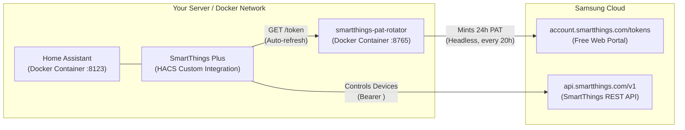

# SmartThings PAT Refresher & Rotator

[](https://opensource.org/licenses/MIT)
[](https://hacs.xyz)

Keep using Samsung SmartThings with **Home Assistant** (in Docker) **100% free forever**, bypassing Samsung's 24-hour Personal Access Token (PAT) limitation and avoiding their $4.99/month developer fee.

---

## Architecture Overview



---

## 3-Step Setup Guide

### Step 1: One-Time Samsung Login (Desktop)

Run the 1-time setup command locally to log in and approve 2FA:
```bash
# 1. Clone repository
git clone https://github.com/willyzha/smartthings-pat-refresher.git
cd smartthings-pat-refresher

# 2. Install rotator dependencies & Playwright Chromium
pip install -e ".[rotator]"
playwright install chromium

# 3. Launch the 1-time setup browser
smartthings-pat-rotator setup
```

1. Chromium will open to Samsung's login page.
2. Sign in with your Samsung Account.
3. Complete 2-Step Verification (SMS or tap approve on your Galaxy device) and check **"Remember this device"**.
4. Once you reach the Personal Access Tokens dashboard, close the browser.
5. All session cookies and device trust tokens are safely stored in `./data/session`.

---

### Step 2: Spin Up the Rotator Container (`docker-compose`)

Deploy the rotator companion container next to your Home Assistant:

```yaml
services:
  smartthings-pat-rotator:
    image: smartthings-pat-rotator:latest
    build: .
    container_name: smartthings-pat-rotator
    restart: unless-stopped
    ports:
      - "8765:8765"
    volumes:
      # Mount the data folder containing your 1-time authenticated session
      - ./data:/app/data
    environment:
      - PYTHONUNBUFFERED=1

  # Home Assistant (example on the same Docker network):
  # homeassistant:
  #   image: ghcr.io/home-assistant/home-assistant:stable
  #   container_name: homeassistant
  #   restart: unless-stopped
  #   ports:
  #     - "8123:8123"
  #   volumes:
  #     - /path/to/ha/config:/config
```

Start the container:
```bash
docker compose up -d
```
The rotator runs in the background, spins up headless Chromium for ~15 seconds once every 20 hours to auto-mint a fresh 24h PAT, cleans up expired tokens, and serves the active token at `http://smartthings-pat-rotator:8765/token`.

---

### Step 3: Install the HACS Integration

1. In Home Assistant, open **HACS** > **Integrations**.
2. Click the top-right menu (3 dots) > **Custom repositories**.
3. Add repository URL:
   ```text
   https://github.com/willyzha/smartthings-pat-refresher
   ```
   Category: **Integration**.
4. Download **SmartThings Plus** and restart Home Assistant.
5. Navigate to **Settings** > **Devices & Services** > **Add Integration**.
6. Search for **SmartThings Plus**.
7. Enter the Rotator URL:
   ```text
   http://smartthings-pat-rotator:8765
   ```
   *(Or `http://<server-ip>:8765` if on different hosts)*.
8. Click **Submit**! 

Home Assistant will fetch the active token, discover all your devices (switches, lights, sensors, thermostats, locks), and automatically renew the token on every poll without you ever touching a 24-hour token manually again.

---

## Supported Home Assistant Platforms

- 💡 **Lights**: Dimmers and bulbs with 0–100% to 0–255 brightness scaling.
- 🔌 **Switches**: Smart plugs, outlets, and wall switches.
- 🌡️ **Sensors**: Temperature (°C/°F), humidity (%), battery (%), power (W), energy (kWh), illuminance (lx).
- 🚪 **Binary Sensors**: Motion, contact (doors/windows), moisture (leaks), presence, smoke.
- ❄️ **Climate**: Thermostat mode control (Heat/Cool/Auto/Off) and heating/cooling setpoints.
- 🔒 **Locks**: Smart door locks with lock/unlock control and state reporting.

---

## Development & Testing

```bash
# Run tests
pytest -v

# Run linter
ruff check .
```

---

## License

This project is licensed under the [MIT License](LICENSE).
