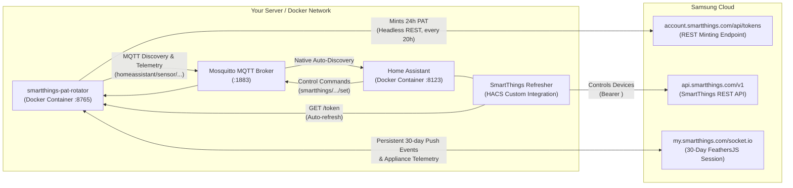

# SmartThings PAT Refresher & Rotator

[](https://opensource.org/licenses/MIT)
[](https://hacs.xyz)

Keep using Samsung SmartThings with **Home Assistant** (in Docker) **100% free forever**, bypassing Samsung's 24-hour Personal Access Token (PAT) limitation and avoiding their $4.99/month developer fee.

---

## Architecture Overview



---

## 3-Step Setup Guide

### Step 1: Initial Samsung Authentication

To mint tokens automatically, the rotator companion container needs your initial authenticated Samsung session cookies. You only need to do this once.

Choose either **Option A (Headless / Recommended)** or **Option B (Desktop)**:

#### Option A: Headless Server / Cookie Import (Recommended for Unraid, Proxmox, TrueNAS, VPS)

1. Open your desktop browser (Chrome, Edge, Firefox, Brave) and navigate to:
   [https://account.smartthings.com/tokens](https://account.smartthings.com/tokens)
2. Sign in to your Samsung Account and complete 2-Step Verification.
3. Export your cookies using either:
   - **Method 1 (Cookie-Editor Extension)**: Install the [Cookie-Editor extension](https://cookie-editor.cgagnier.ca/), click the extension icon on `account.smartthings.com`, click **Export** > **Export as JSON**, and copy the JSON.
   - **Method 2 (DevTools Network Tab)**: Press `F12` > click **Network** tab > refresh the page > click the `tokens` request > copy the `Cookie:` header value from Request Headers.
4. Import into the rotator container:
   ```bash
   # Method A: Save directly to data/cookies.txt
   mkdir -p data
   echo "YOUR_COOKIE_STRING_OR_JSON" > data/cookies.txt

   # Method B: Or run the CLI command:
   docker compose run --rm smartthings-pat-rotator smartthings-pat-rotator import-cookies
   # (Paste your JSON or cookie string when prompted, then press Enter + Ctrl-D)
   ```
The rotator validates your session against Samsung's API and mints your first active 24-hour PAT in milliseconds!

#### Option B: Desktop Browser Automation (Machines with GUI Display)

If running on a machine with a desktop display (or X11 forwarding):
```bash
./scripts/interactive_login.sh
```
A Google Chrome window opens directly to Samsung login without bot detection flags. Complete your login and 2FA; as soon as the Personal Access Tokens dashboard loads, the script automatically captures your live session cookies, mints a fresh token, and closes the browser for you!

---

### Step 2: Spin Up the Rotator Companion Container

Add `smartthings-pat-rotator` to your `docker-compose.yml` (or run next to your Home Assistant container):

```yaml
services:
  smartthings-pat-rotator:
    build: .
    container_name: smartthings-pat-rotator
    restart: unless-stopped
    ports:
      - "8765:8765"
    volumes:
      - ./data:/app/data
    environment:
      - PYTHONUNBUFFERED=1
```

Start the container:
```bash
docker compose up -d
```

The rotator container will:
- Serve the active PAT at `http://localhost:8765/token`.
- Provide a health endpoint at `http://localhost:8765/health`.
- Offer a transparent proxy with automatic Bearer token injection at `http://localhost:8765/v1/...`.
- Run a background worker that mints a fresh token every 20 hours and purges older tokens on Samsung's cloud.
- Maintain a **30-day persistent rolling session** with `my.smartthings.com` Socket.IO for real-time appliance push events.

---

### Step 3 (Optional & Recommended): Home Assistant MQTT Discovery Bridge

If you have SmartThings appliances (Washer, Dryer, Refrigerator, Range, Air Quality Monitor, Door Locks, Plugs), you can expose them directly to Home Assistant as **native entities with zero custom code** using the built-in Home Assistant MQTT Discovery Bridge!

1. Edit `docker-compose.yml` to specify your MQTT broker:
   ```yaml
   services:
     smartthings-pat-rotator:
       # ...
       environment:
         - PYTHONUNBUFFERED=1
         - MQTT_HOST=192.168.1.50          # IP of your Home Assistant / Mosquitto broker
         # - MQTT_PORT=1883
         # - MQTT_USER=homeassistant
         # - MQTT_PASSWORD=secret
   ```
2. Restart the rotator:
   ```bash
   docker compose up -d
   ```
3. Open Home Assistant:
   - Navigate to **Settings** > **Devices & Services** > **MQTT**.
   - Your SmartThings devices and appliances will **automatically appear** with all their sensors (PM2.5, Washer cycle state, Dryer mode, Refrigerator cooler/freezer temperatures, Front Door lock, switch controls) organized neatly under their device cards!

---

### Step 4: Install the HACS Integration (For standard REST devices)

1. In Home Assistant, open **HACS** > **Integrations**.
2. Click the top-right menu (3 dots) > **Custom repositories**.
3. Add repository URL:
   ```text
   https://github.com/willyzha/smartthings-pat-refresher
   ```
   Category: **Integration**.
4. Download **SmartThings Refresher** and restart Home Assistant.
5. Navigate to **Settings** > **Devices & Services** > **Add Integration**.
6. Search for **SmartThings Refresher**.
7. Enter the Rotator URL:
   ```text
   http://smartthings-pat-rotator:8765
   ```
   *(Or `http://<your-host-ip>:8765` if Home Assistant is running in host networking mode)*.
8. Click **Submit**!

Home Assistant connects to the rotator, retrieves the active token, discovers all your devices across all 19 native Home Assistant platforms, and keeps them continuously refreshed without ever needing a manual token or paying Samsung's developer fee.

---

## Verifying the Deployment

You can check your rotator container at any time:

```bash
# Check container health and time remaining on active PAT
curl http://localhost:8765/health

# Output:
# {"status": "healthy", "token_available": true, "hours_left": 24.0, "expiring_soon": false}

# View current token
curl http://localhost:8765/token

# Trigger a manual on-demand token rotation
curl -X POST http://localhost:8765/rotate

# Test device querying via transparent proxy
curl http://localhost:8765/v1/devices

# Check 30-day dashboard session health & MQTT bridge status
curl http://localhost:8765/dashboard/health

# List all discovered SmartThings appliances and devices
curl http://localhost:8765/dashboard/devices

# Inspect real-time status of a specific device (e.g. Washer or Lock)
curl http://localhost:8765/dashboard/devices/<DEVICE_ID>/status

# Send an on/off command to a switch via dashboard Socket.IO
curl -X POST http://localhost:8765/dashboard/devices/<DEVICE_ID>/command \
  -H "Content-Type: application/json" \
  -d '{"capability": "switch", "command": "on"}'
```

---

## Moving Between Servers (Headless Migration)

To move this setup to a headless server (e.g., Unraid, Proxmox, TrueNAS, Raspberry Pi):
1. Clone the repository on your headless server.
2. Copy the `data/cookies.txt` (or `data/storage_state.json`) file from your initial machine to `data/` on the target server.
3. Run `docker compose up -d`.
4. Point Home Assistant to `http://<headless-server-ip>:8765`.

---

## Non-Vendored Wrapper Architecture

Unlike integrations that copy or vendor third-party libraries and entity platforms, `smartthings_refresher` is a lightweight wrapper that dynamically binds to Home Assistant's built-in `smartthings` platforms and `pysmartthings`:
- **Zero Vendored Code**: Delegates entity setup directly to Home Assistant's core platforms (`switch`, `light`, `sensor`, `binary_sensor`, `climate`, `cover`, `fan`, `lock`, `media_player`, `number`, `scene`, `select`, `time`, `update`, `vacuum`, `valve`, `water_heater`).
- **Always Up-to-Date**: Automatically inherits all official Home Assistant device updates, capability additions, and bugfixes.
- **Independent Domain**: Runs as domain `smartthings_refresher` so it safely coexists alongside the built-in integration.

---

## Supported Home Assistant Platforms

- 💡 **Lights**: Dimmers and bulbs with 0–100% to 0–255 brightness scaling.
- 🔌 **Switches**: Smart plugs, outlets, and wall switches.
- 🌡️ **Sensors**: Temperature (°C/°F), humidity (%), battery (%), power (W), energy (kWh), illuminance (lx).
- 🚪 **Binary Sensors**: Motion, contact (doors/windows), moisture (leaks), presence, smoke.
- ❄️ **Climate**: Thermostat mode control (Heat/Cool/Auto/Off) and heating/cooling setpoints.
- 🔒 **Locks**: Smart door locks with lock/unlock control and state reporting.
- 🪟 **Covers**: Blinds, shades, and garage doors.
- 🌀 **Fans**: Speed and power control.
- 📺 **Media Players**: Volume, playback, and source selection.

---

## Development & Testing

```bash
# Run unit tests
pytest -v

# Run linter
ruff check .
```

---

## License

This project is licensed under the [MIT License](LICENSE).
