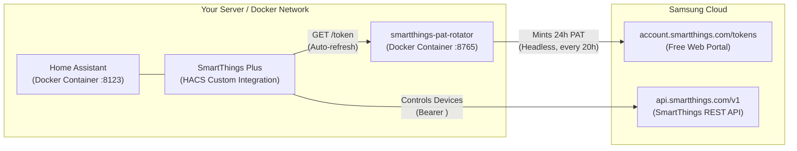

# SmartThings PAT Refresher & Rotator

[](https://opensource.org/licenses/MIT)
[](https://hacs.xyz)

Keep using Samsung SmartThings with **Home Assistant** (in Docker) **100% free forever**, bypassing Samsung's 24-hour Personal Access Token (PAT) limitation and avoiding their $4.99/month developer fee.

---

## Architecture Overview



---

## 3-Step Setup Guide

### Step 1: One-Time Samsung Authentication

You can authenticate using either **Option A (Cookie Import - Fastest)** or **Option B (Interactive Browser Login)**:

#### Option A: Cookie Import (Headless / Recommended)
If your server is headless or running remotely:
1. Log in to [account.smartthings.com/tokens](https://account.smartthings.com/tokens) in your normal web browser.
2. Open DevTools (`F12`) > **Network** tab, refresh the page, click the `tokens` request, and copy the `Cookie` header string (or export via Cookie-Editor).
3. Import the cookies into the rotator:
```bash
# Save to data/cookies.txt
mkdir -p data
echo "YOUR_COOKIES_HERE" > data/cookies.txt

# Or run the CLI command:
docker compose run --rm smartthings-pat-rotator smartthings-pat-rotator import-cookies "YOUR_COOKIES_HERE"
```
The rotator immediately verifies the cookies against Samsung's API and mints your first active PAT in milliseconds!

#### Option B: Interactive Browser Setup (Desktop)
If you have a local desktop display:
```bash
# Launch interactive browser
smartthings-pat-rotator setup
```
1. Chromium opens to Samsung's login page.
2. Sign in with your Samsung Account and complete 2FA.
3. Once you see the Personal Access Tokens dashboard, close the browser.

---

### Step 2: Spin Up the Rotator Container (`docker-compose`)

Deploy the rotator companion container next to your Home Assistant:

```bash
docker compose up -d
```

The container automatically:
- Hosts the active PAT at `http://localhost:8765/token` (and `http://localhost:8765/health`).
- Serves a transparent reverse proxy at `http://localhost:8765/v1/...` that auto-injects bearer authentication.
- Automatically checks every 10 minutes and rotates the PAT via direct REST API before it reaches 20 hours of age.
- Cleans up older automated PATs on SmartThings cloud.

---

### Step 3: Install the HACS Integration

1. In Home Assistant, open **HACS** > **Integrations**.
2. Click the top-right menu (3 dots) > **Custom repositories**.
3. Add repository URL:
   ```text
   https://github.com/willyzha/smartthings-pat-refresher
   ```
   Category: **Integration**.
4. Download **SmartThings Plus** and restart Home Assistant.
5. Navigate to **Settings** > **Devices & Services** > **Add Integration**.
6. Search for **SmartThings Plus**.
7. Enter the Rotator URL:
   ```text
   http://smartthings-pat-rotator:8765
   ```
   *(Or `http://<server-ip>:8765` if on different hosts)*.
8. Click **Submit**! 

Home Assistant will fetch the active token, discover all your devices (switches, lights, sensors, thermostats, locks), and automatically renew the token on every poll without you ever touching a 24-hour token manually again.

---

## Supported Home Assistant Platforms

- 💡 **Lights**: Dimmers and bulbs with 0–100% to 0–255 brightness scaling.
- 🔌 **Switches**: Smart plugs, outlets, and wall switches.
- 🌡️ **Sensors**: Temperature (°C/°F), humidity (%), battery (%), power (W), energy (kWh), illuminance (lx).
- 🚪 **Binary Sensors**: Motion, contact (doors/windows), moisture (leaks), presence, smoke.
- ❄️ **Climate**: Thermostat mode control (Heat/Cool/Auto/Off) and heating/cooling setpoints.
- 🔒 **Locks**: Smart door locks with lock/unlock control and state reporting.

---

## Development & Testing

```bash
# Run tests
pytest -v

# Run linter
ruff check .
```

---

## License

This project is licensed under the [MIT License](LICENSE).
